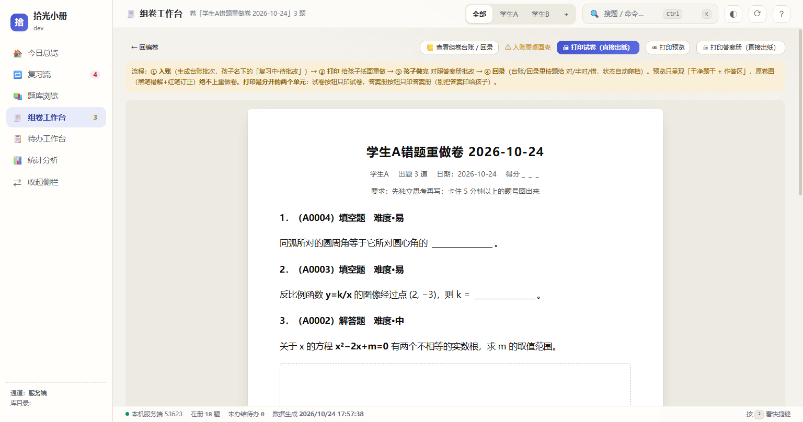
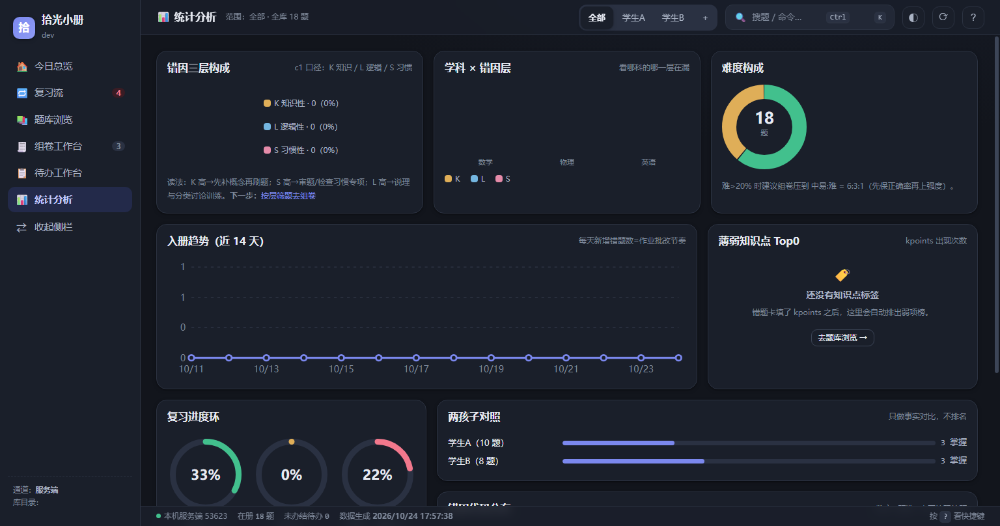

# 拾光小册（GlimmerNote）

> **完全离线、数据全留在本机的错题本工具。** 运行时不与任何外部服务通信：不上传、不收集、无遥测。
> 联网的**精确边界**（含构建期与第三方运行时）见 [联网情况](#联网情况分阶段可对证)——说不清的地方不硬说。
> 本仓库是**开发区**（唯一代码真源）。运行区另有目录，只装产物，不装源码。

## 它解决什么问题

孩子做完错题后，复习最怕两件事：**错题散在纸质卷上找不到**、**复习没有节奏**。
拾光小册把错题录进来（题干、配图、答案、错因），按间隔重复排复习计划，
并按「孩子的水平」重新组卷打印——全过程在本机完成，家长自己就能维护数据。

## 界面






> 界面是真的，数据是假的：这三张图由 `scripts\make-doc-shots.mjs` 用**纯合成演示库**渲染
> （学生A / 学生B，合成题），不是手绘示意，也不含任何真实题库内容。

## 三区模型

| 区 | 目录 | 放什么 | 能不能手改 |
|---|---|---|---|
| **开发区** | 本仓库（GlimmerNotedev） | 源码、测试、fixtures、打包脚本 | ✅ 只在这里改 |
| **运行区** | 与仓库同级的 `GlimmerNote\` | `app\`（部署产物）+ `数据\`（真实题库） | ❌ 产物不手改 |
| **冻结区** | 旧版目录（本机只读保留，不出网） | 旧版，只读保留 | ❌ 不再改 |

**口诀：源码只住在 dev；运行区是「装出来的」，不是「写出来的」。**

## 系统要求

| 项 | 要求 | 说明 |
|---|---|---|
| 操作系统 | **Windows 10 1809+ 或 Windows 11**（64 位） | 桌面壳依赖 WebView2 |
| **WebView2 运行时** | **必须安装**：Evergreen Runtime | 多数 Win11 已内置；Win10 若提示缺组件，装 [Microsoft Edge WebView2 Runtime](https://developer.microsoft.com/microsoft-edge/webview2/) 即可 |
| 磁盘空间 | **≥ 2 GB** 可用 | 发行包约 **38 MiB**；解压后 `app\` 约 **102 MiB**，其中内置的 `node.exe` 占 **99.9 MiB**，程序本体（除 `node.exe` 外）约 **2 MiB**。题库含扫描图，按每张 200 KB～1 MB 估算 |
| Node.js | **发行包内已内置** | 最终用户**不需要**安装 Node.js——包里的 `app\node.exe` 就是它。从源码构建或跑门禁才需要装 **≥ 18** |
| 浏览器 | 不需要 | 程序自带桌面壳，不依赖系统浏览器 |

> 程序与数据**物理分离**：`app\` 可以整个删掉重装，`数据\` 不受影响。

## 获取

发行包通过 **GitHub Releases** 提供。本仓**不含**打包产物（`release\` 被 `.gitignore` 挡住），
要从源码自己出包见下文「常用命令」：

- 每个版本一个文件：`GlimmerNote-<版本>-win-x64.zip`（版本形如 `2026.10.28.01`）
- 同目录有 `.sha256` 校验文件，**下载后请先校验再解压**：

```powershell
# 把 <版本> 换成实际版本号
Get-FileHash .\GlimmerNote-<版本>-win-x64.zip -Algorithm SHA256
# 与 .sha256 文件里的那一行逐字比对
Get-Content .\GlimmerNote-<版本>-win-x64.zip.sha256
```

解压后运行 `app\` 目录里的 **`拾光小册.exe`** 即可，**绿色免安装**，无需管理员权限。

> **为什么包这么大**：`app\node.exe` 一个文件解压后就有 **99.9 MiB**（压缩后构成发行包的主体）；
> 桌面壳 `拾光小册.exe` 本体只有 **0.2 MB** 量级，`app\` 里除 `node.exe` 之外的全部文件合计约 **2 MiB**。
> 本程序的写盘动作（新建学生／组卷／批改／待办办结）由 `app\tools\` 里的 .mjs 工具完成，
> 桌面壳按名字调用 `node.exe`。把它放在程序同目录，程序就能自己找到——**你不用装 Node，也不用联网**。
> 内置版本与 SHA256 见包内 `内置Node说明.txt`，许可见 `node-LICENSE.txt`。
> 想自己检查这一点：`src\tools\` 下的所有 `.mjs` 工具都只用 Node 内置模块，没有 `node_modules`。

## 反馈

- **发现 BUG / 想提需求**：请开 [Issue](../../issues)，按模板填（模板会问版本号、复现步骤、期望结果）。
- 提问前建议先看 [常见问题](#常见问题faq)。
- **安全漏洞请走 [`SECURITY.md`](SECURITY.md) 里的私密渠道，不要公开提 issue。**

## 贡献

单人维护项目，但欢迎 PR。**动手前必读 [`CONTRIBUTING.md`](CONTRIBUTING.md)**，里面有：

- 分支策略（主干开发）
- 提交信息格式（`type(scope): subject`，首行 ≤72 字符）
- **回退三层**：提交错了用 `git revert`，版本有问题用归档件回滚，数据损坏用快照恢复
- 禁止事项（含**禁止 `git reset --hard`**）
- 新功能必须同提交补阴性对照测试

最小自检：

```powershell
node tests\run.mjs quick      # 门禁主体
node tools\lint.mjs           # 语法 / 硬编码路径 / 行尾空白 / 调试残留
```

## 常用命令

```powershell
# 【新克隆 / 换机 第一步】零依赖自检：不需要 exe、不需要真实题库，3 秒
node tests\run.mjs fixture

# 打一个发布包（产出 release\GlimmerNote-<版本>-win-x64.zip + .sha256）
powershell -File scripts\build-release.ps1

# 部署到运行区（只替换 app\，数据\ 全程不碰）
powershell -File scripts\deploy.ps1 -Zip release\GlimmerNote-<版本>-win-x64.zip

# 看部署历史
powershell -File scripts\rollback.ps1 -List

# 退回上一版（数据不动）
powershell -File scripts\rollback.ps1

# 退回指定版本
powershell -File scripts\rollback.ps1 -Version <版本>

# 流水线自检（回滚演练，不动真实运行区）
powershell -File scripts\selftest-pipeline.ps1

# ── 配方（AI 方法层）──
# 程序不带大脑：它不联网、不内置模型、不含 API Key。
# 录题靠「配方」——一套纯文本的提示词 + 输出契约 + 验收清单 + 反例库，交给你自己的 AI 执行。
# 看有哪些配方、各自版本与指纹
node src\tools\_配方.mjs 清单

# 给一份原图出一张「录题任务单」（含提示词全文与原图 sha256）
node src\tools\_配方.mjs 组装 --recipe ingest-page --subject 数学 --image <原图路径> --out 任务.md

# 校验 AI 回传的 cards.json（schema 真校验，不合格逐条指出）
node src\tools\_配方.mjs 校验 --in cards.json

# 看收件箱还剩哪些没处理（已处理的不再列；--all 连已归档的一起列）
node src\tools\_配方.mjs 收件箱
node src\tools\_配方.mjs 收件箱 --all

# 给「换了自己的 AI」打分：拿黄金样本比一比
node src\tools\_配方.mjs 自检 --recipe ingest-single --in cards.json
```

> 收件箱里「已处理」的判据是可查证的：**那份材料已经被用过**。认的时候认**四条**：
>
> 1. **路径**——它的库根相对路径就是台账里记的那条；
> 2. **内容**——它的 sha256 与台账引用到的、或卡片目录里的 `原卷截图.jpg` **字节完全相同**；
> 3. **批次**——台账引用了同一批次下的任一文件，或它的来源写明了同一天的作业
>    ⇒ 整批都算处理过（同一份作业是**一次处理**的：同一次扫描、同一次挑错，
>    某页没挑出错题不代表这份作业没处理）；
> 4. **同族**——同一份材料的其它页（去掉页码后同族）。
>    ⚠ 2026-10-31 收窄（外部审查 C02）：「转置」不再单独构成"已处理"。改前是"尺寸互为转置 +
>    文件体积同量级"就归档，实测会把**内容无关**、恰好横拍/竖拍尺寸互补的照片也判成已处理
>    （用户看到的是"这照片明明没做过，它却说处理过"）。现在尺寸/体积只用来**挑候选**，
>    结论必须有内容证据（sha256 相等）。代价：真正的"转正后另存一份"字节必然不同，
>    这类件会**留在待处理清单**里 —— 本仓取舍是"宁可多列一张，不可误藏一张"。
>
>    第 2 条不是多余的：台账里同一张照片的路径有时记收件箱原样、有时记原卷库里重命名后的那份
>    （`…/p08-src61.jpg` ↔ `九年级/英语/原卷/课课练9上-p08-src61.jpg`），
>    **内容同一张、路径两套**，只认路径会漏判（用户 2026-10-31 实测复报「这些照片我们都处理过了呀」）。
>
> 这类照片不再出现在待处理清单里，也不再为它算内容哈希——列表因此又短又快。
> **文件不会被移动或删除**；没有台账（新库）、台账读不动、或台账指向的文件不在盘时，
> 一律退回"全部待处理"并给出原因，**宁可多显示也不许把没做的照片藏起来**。
> 读不动或越出库根的文件会被跳过，并在输出里**报出数量**（不许静默少列）。

> 配方怎么改、怎么加反例、发现新坑怎么回流，见 [`docs\配方规范.md`](docs/配方规范.md)。
> 一句话：**改正文要极慎重，加反例随便加**——反例是安全的那一半。

## 新克隆自检（拿到源码后按这个顺序）

**为什么需要这一节**：本仓的门禁分三档，各需要不同的前置条件。
不知道这件事的人第一次克隆完跑 `quick`，会看到一堆红，然后以为代码坏了。

| 档 | 命令 | 需要什么 | 干净克隆能跑吗 |
|---|---|---|---|
| **零依赖自检** | `node tests\run.mjs fixture` | 只要 Node ≥18 | **能**，数秒内 exit 0（本机实测约 6 s；数字随机器变，别当硬指标） |
| 全量单元+界面 | `node tests\run.mjs quick` | 已构建的 `src\app\拾光小册.exe` + 一个题库 | 不能，要先补齐 |
| 发版前 | `node tests\run.mjs full` | quick + 重编 + 带调试口重启 | 不能，要先补齐 |

**三步补齐**：

```powershell
# 0) 让 git 用版本化钩子（克隆不会带钩子，所以这一步不能省）
powershell -File scripts\install-hooks.ps1

# 1) 零依赖自检（立刻可跑）
node tests\run.mjs fixture

# 2) 拉三方依赖 + 编桌面壳（产出被 .gitignore 挡住的 exe 与 dll）
powershell -File scripts\fetch-deps.ps1      # 首次需要联网拉 WebView2 包；离线见脚本头注释
powershell -File src\shell\build.ps1

# 3) 指向一个题库（开发机直接跑就用同级 ..\错题本；否则设环境变量）
$env:CTB_TEST_LIB = 'D:\你的题库目录'
node tests\run.mjs quick
```

> **关于第 0 步**：`.git/hooks/` 天生不入库，所以"开发机上有钩子"不等于"新克隆有钩子"。
> `.githooks\` 是钩子的**版本化真源**（`pre-commit` 跑 lint + fixture + 运行区漂移检查；`commit-msg` 校验提交信息格式；
> `pre-push` 拦对 `main` 的强制推送），`install-hooks.ps1` 做的事是设 `git config core.hooksPath .githooks`
> ——**不往 `.git/hooks/` 拷贝任何文件**（幂等，重复跑无副作用）。

> 没有题库也能跑一部分：仓库自带合成库 `fixtures\库-最小\`，
> 当检测不到真库时会自动用它（`tests\_测试环境.cjs` 的第三个候选）。
> 合成库只够跑源码级断言，**包含真实影像的门禁（配图门禁 / 原卷台账门禁）会 SKIP 并写明原因**。

## 版本号规则（日期制）

格式：`YYYY.MM.DD.NN`　例：`2026.10.23.01`

- 前四段是**发版日期**（不是代码写成的日期）
- `NN` 是**当天第几版**，两位数，从 `01` 起
- 同一天再发就 `02`、`03`……换天自动重置为 `01`
- 好处：一眼看出新旧、天然有序、不需要维护"主.次.修订"的语义判断
- 不兼容变更（数据格式变化）另在 `CHANGELOG.md` 里用 `⚠ 破坏性变更` 标注，不靠版本号表达

版本号唯一真源：`VERSION.json`。打包脚本会校验格式，不符合 `YYYY.MM.DD.NN` 直接报错。

## 发版检查单

**前置（只需一次）**：`powershell -File scripts\install-hooks.ps1`（把 `core.hooksPath` 指向 `.githooks\`）。

1. 改 `VERSION.json` 的 `version`
2. `CHANGELOG.md` 顶部加条目，**必须含两行**：`**变更分类**：…` 与 `**升级影响**：…`（门禁会逐版校验）
3. 跑门禁：`node tests\run.mjs full` + `node tools\lint.mjs`（`quick` 是底线，`full` 才覆盖重编与打印链路）
4. `powershell -File scripts\build-release.ps1`
5. `powershell -File scripts\deploy.ps1 -Zip <刚出的包>`
6. 自用 1~2 天
7. `git tag -a v<版本> -m "<版本> release point"` + 推 GitHub Release

**第 7 步不是可选项**：铁律 3 要求"每次发布留三样（tag / zip / SHA256）"，而本轮审计实测
`release\` 有 30 个包、git tag 只有 2 个——**"打过包"不等于"发过版"**。查漏命令：

```powershell
# 有包但没 tag 的版本（应为空）
$tags = git tag | ForEach-Object { $_ -replace '^v', '' }
Get-ChildItem release\*.zip | ForEach-Object { ($_.BaseName -split '-')[1] } |
  Where-Object { $tags -notcontains $_ } | Sort-Object -Unique
```

## 常见问题（FAQ）

**Q：数据存在哪？会上传吗？**
A：全部在运行区的 `数据\` 目录。运行时**不与任何外部服务通信**，没有任何上传代码。
联网的完整边界（含构建期与第三方运行时）见 [联网情况](#联网情况分阶段可对证)。备份就是复制这个目录。

**Q：升级会不会弄坏我的题库？**
A：不会。部署脚本只替换 `app\`，`数据\` 在脚本层面被排除。
每次发版前后都可以用 `scripts\selftest-pipeline.ps1` 演练一遍（会在临时沙箱里跑，不碰真实数据）。

**Q：怎么彻底卸载？**
A：删掉整个运行区目录即可（程序是绿色免安装，没有注册表残留）。
只想清空数据就删 `数据\` 子目录——**删之前请先备份**。

**Q：升级后发现不好用，怎么退回上一版？**
A：`powershell -File scripts\rollback.ps1`。回滚用的是 `release\` 里的**归档字节**，不是重新构建
（本机构建产物不保证跨机可复现，回滚只能用原样字节）。

**Q：为什么杀毒软件报警？**
A：程序用的是**自签证书**（不是花钱买的正规代码签名证书），所以 Windows 仍会提示"未知发布者"。
这属预期行为；请核对 SHA256 与发布页公布的一致后再放行（**发布前该页面尚不存在**，见「获取」节的状态说明）。

**Q：双击后弹「初始化失败 / 请求的资源在使用中（0x800700AA）」，或者日志一个字都没有？**
A：先跑一次急救脚本，它会告诉你现在是什么状态、并顺手修好：

```powershell
powershell -NoProfile -ExecutionPolicy Bypass -File scripts\fix-integrity.ps1
```

这条命令处理的是 Windows 的**强制性完整性标签**：程序所在目录若被写上低完整性（Low）标签，
新写入的文件会继承它，而带低标签的可执行文件只能跑在低完整性上下文里——那种上下文写不了用户目录，
于是 WebView2 建不出数据目录（`0x800700AA` 就是 `ERROR_BUSY`）、日志也写不进去（看起来像"程序毫无反应"）。
脚本只改标签，不动文件内容与所有者；`-WhatIf` 可以先看后改。
经 `scripts\deploy.ps1` 正常部署的程序，每次部署已经自动复位，无需手动跑。

## 联网情况（分阶段可对证）

> 一句话说不清的事不硬说：**"完全离线"是运行时的性质，不是整个仓库每一行代码的性质。**
> 下面把联网按**阶段**切开，每段给出可自己复算的检查命令。**哪一段说了假话，用命令就能抓到。**

| 阶段 | 会不会出网 | 出到哪 | 怎么自己验 |
|---|---|---|---|
| **① 运行时**（终端用户双击 `拾光小册.exe` 使用） | **不出网**。只与本机 `127.0.0.1` 上的服务端通信（端口见 `src\tools\_服务端.mjs`） | 无 | `git grep -n -E "fetch\(|XMLHttpRequest|https?\.request|WebSocket|EventSource|sendBeacon|net\.connect|dns\." -- src` → 命中应只有 `host.js` 指向 `127.0.0.1` 的本地 fetch 与 `_服务端.mjs` 的 `listen('127.0.0.1')` |
| **② 运行时·渲染数据里的图片路径** | **不出网**。配图路径一律按**本地相对路径**解析；渲染层对 `http(s):` 开头的路径**直接拒绝**（不加载） | 无 | `git grep -n "https\?:" -- src/app/js/host.js` 看 `H.asset` 的白名单分支；另见 `_配图门禁.mjs` 对远程路径的检查 |
| **③ 点外部链接** | **会**。壳把 `http(s)` 链接交给**系统浏览器**打开（不是程序自己去请求） | 系统默认浏览器 | `src\shell\CTBShellV2.cs` 里 `OpenWithSystem` 的调用点 |
| **④ 构建/发版**（只有开发者会跑） | **会**。`fetch-deps.ps1` 从 `api.nuget.org` 下载 WebView2（HTTPS）；`src\shell\build.ps1` 访问 DigiCert 取代码签名**时间戳**（HTTPS） | nuget.org / digicert.com | 两个脚本头注释各自写明；`git grep -n "https\?://" -- scripts src/shell` |
| **⑤ 第三方运行时**（Microsoft Edge WebView2） | **不受本程序控制**。桌面壳内嵌 WebView2 渲染引擎，其自身行为由微软组件决定；本程序未对其加网络抑制开关 | 未知（微软组件自身策略） | `src\shell\CTBShellV2.cs` 里的 WebView2 初始化段 |

**明确承诺（这几条是实测的，不是口号）**：

- **不上传**：全仓零上传代码。
- **不收集**：无遥测、无分析、无错误上报（`git grep -n -E "telemetry|analytics|sentry|report" -- src` 无相关命中）。
- **数据只在本机**：唯一真源在运行区 `数据\`，写入走 `src\tools\_安全写.mjs`（临时文件 + fsync + rename）。

**明确不承诺**：WebView2 运行时自身的网络行为（第 ⑤ 段）本程序管不了。若你要绝对断网，用系统防火墙/断网运行——**功能不受影响**（除第 ③ 段的外部链接）。

## 严格性自评（GSE-STD v1.0）

本项目的工程严格性按 [`GSE-STD 通用软件工程标准 v1.0`](docs\等级与NA清单.md) 自评：

- **目标等级 = L1 + L2**（依据：公开发布给陌生人使用、单人维护）
- **L3 非目标**：单人、无监管场景；条款逐条 N/A 并写明理由
- **上一轮全量实测**：138 条判据 → PASS 67 / FAIL 47 / N/A 22 / UNK 2

**完整声明、N/A 清单、当前阻断项、以及"标准自身的缺陷"在哪里** → [`docs\等级与NA清单.md`](docs\等级与NA清单.md)。
**维护者与决策机制、路线（含"不做"清单）、架构高层视图** → [`docs\治理与架构.md`](docs\治理与架构.md)。

> ⚠ 本仓 `L1/L2/L3` 在**配方文本**里另有含义（错因代码：分类不全 / 推理断链 / 转化不等价，见 `src\recipes\_core\cause.md`），
> 与上面的严格性等级**无关**。看到 `L2` 先确认是哪一套——这条歧义警告本身是 GSE-STD §3 的要求。

## 铁律

1. **运行区里的东西永远是产物，不是源头。** 谁都不在 `GlimmerNote\app\` 里改代码。
2. **部署只动 `app\`。** `数据\` 由脚本层面保证不触碰。
3. **每次发布必须留三样**：git tag、zip 产物、SHA256。
4. **回滚必须演练过。** 没演练过的回滚等于没有。
5. **dev 里能跑测试，靠 `fixtures\`，不靠真数据。**
6. **题干里的"空"是数据，不是装饰。** 每道有空的题都必须逐空登记答案（`answerSlots`），
   答案要写在图里的题必须登记 `answerMode: figure`（组卷不留答题区），长答案不许硬塞横线。
   判据是机器数出来的空位数，见 `docs\作答契约.md` 与 `src\tools\_作答门禁.mjs`（唯一裁判）。

## 目录说明

```
GlimmerNotedev\
├─ src\          源码（app 前端 / tools 工具链 / shell 桌面壳 / recipes 配方）
├─ fixtures\     假数据（测试专用，绝不含真实用户数据）
├─ release\      打包产物（不入 git）
├─ scripts\      build-release / deploy / rollback / fetch-deps / selftest-pipeline
│                + verify-deploy（部署一致性校验）/ setup-remote（首次发布）/ install-hooks（挂门禁钩子）
│                + make-fixture-lib / make-demo-lib / make-doc-shots / make-png（素材与截图生成）
├─ tests\        门禁（run.mjs 是唯一入口）
├─ tools\        lint 等开发工具
├─ docs\         文档 + docs\images\ 界面截图
├─ VERSION.json  版本号唯一真源
└─ CHANGELOG.md
```

> `归档\` 只在维护者本机存在（过时物料的去处，按 `.gitignore` 不入 git），**新克隆里没有它**——这是预期，不是缺件。

### 三层各管一件事

| 层 | 位置 | 装什么 | 变化频率 |
|---|---|---|---|
| **内核** | `src\app\` `src\tools\` `src\shell\` | 数据、台账、门禁、渲染、打印 | 低（走发布链路） |
| **配方** | `src\recipes\` | AI 怎么识别、怎么判错、怎么转印刷体 | **高**（加一条反例就变） |
| **界面** | `src\app\js\` | 只读 `_状态.json`，不加工数据 | 中 |

**内核不认识任何一道题、任何学科**——这是"可插拔"的前提。
配方是纯文本，随包发布（`app\recipes\`），但**只能被读取，不能被程序改写**：
贡献者改配方走 PR（可审可回滚），终端用户只能升级。理由见 [`docs\配方规范.md`](docs/配方规范.md) §八。
